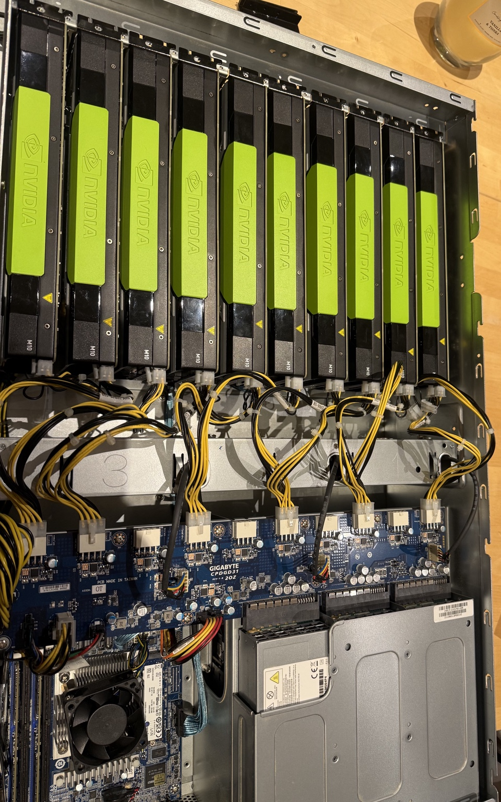
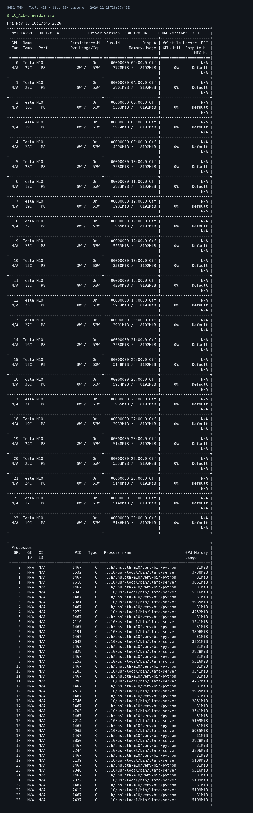

# G431-M10-Inference

An experimental project to turn a GIGABYTE G431-MM0-OT and NVIDIA Tesla M10 cards into a local inference server: investigate firmware boot limits, validate the GPUs, and serve multiple GGUF models through one API.

**Current verified deployment: six M10 cards, 24 independent 8 GiB GPUs, and 24 loaded model instances using nine model variants.** Ten cards failed before Linux at POST code 70; that configuration is not validated. The firmware image labeled F10 is experimental, not an official GIGABYTE release.

*The photo shows ten cards physically installed. The verified running configuration has six cards.*

## From boot to inference

The project has three connected stages. A successful boot alone does not prove that CUDA or an inference workload works.

| Stage | Work and result | Read next |
|---|---|---|
| 1. Firmware and PCI resources | Board-specific AMI PciBus BAR5 experiment; module-level checks pass, but its effect on boot has not been isolated by a controlled comparison | [Patch details](PATCH_DETAILS.md) · [Module reproduction](REPRODUCE.md) |
| 2. Hardware validation | Six cards enumerate as 24 GPUs; each passed allocation and a 1 MiB CUDA copy-and-compare check | [Results and remaining tests](TEST_RESULTS.md) · [Hardware details](software/docs/HARDWARE_VALIDATION.md) |
| 3. Model serving | Unsloth Studio manages llama.cpp runtimes, one per GPU; an adaptive expert API exposes them to chat clients and OpenCode | [Software setup and usage](software/README.md) · [OpenCode](software/docs/OPENCODE.md) |

For the experiment as a whole, start with [results](TEST_RESULTS.md). To use or study the serving layer, start with the [software guide](software/README.md). For a public introduction, see the [community review draft](DISCUSSION_POST.md).

## 1. Firmware: getting past PCI enumeration

The hardware is a GIGABYTE G431-MM0-OT with an MJ11-EC1-OT baseboard. The original BIOS was F09 (2021-09-14), with BMC 12.61.39. Two or three physical M10 cards booted; a five-card attempt stopped before Linux with POST code 70.

The experiment adds an AMI PciBus resource exception for NVIDIA PCI ID `10de:13bd`, targeting I/O BAR5 at configuration offset `0x24`. Its purpose is to reduce legacy I/O-resource pressure during PCI enumeration. BAR0/BAR1/BAR3 and the NVIDIA driver are not changed.

The original post-change report covered four cards and 16 GPU devices. Later testing reached six cards and 24 GPUs. These observations do not establish that the patch alone enabled the additional cards. The supplied experimental module passes 23 exception-emulation scenarios and eight caller-emulation scenarios. See [patch details](PATCH_DETAILS.md) for exactly what those synthetic tests exercise.

The [firmware review bundle](G431_M10_GitHub_Review_Package_EN.zip) contains the patch-builder, archived synthetic results and historical notes. It is a firmware-specific archive; the current deployment state is documented in this repository's [results](TEST_RESULTS.md). It contains no ready-to-flash RBU.

## 2. Hardware: verifying the usable GPUs

A Tesla M10 contains four independent GPUs with 8 GiB each. Six cards expose 24 devices, rather than six unified 32 GiB GPUs. All 24 passed a basic CUDA memory-copy test; this is distinct from sustained compute or thermal validation.

Ten cards looped at POST 70 before Linux. Power cabling and PCI resource allocation remain hypotheses. In particular, the low-MMIO window observed with six cards is smaller than the BAR0 allocations that 40 GPUs would require, but firmware behavior with ten cards has not been established. See [hardware evidence](software/docs/HARDWARE_VALIDATION.md).

Live nvidia-smi capture: all 24 GPUs and their resident processes

Captured over SSH on 2026-11-13 at 16:17:46 UTC. The image renders the unmodified command output; [raw text](software/evidence/nvidia-smi-2026-11-13.txt) and [capture metadata](software/evidence/nvidia-smi-2026-11-13.json) are retained. This is an idle-state snapshot, not a load test. The CUDA version in nvidia-smi is the driver's supported version, not the CUDA library version used by the inference runtime.

## 3. Inference: using the available GPUs

The serving layer uses Unsloth Studio to manage llama.cpp GGUF inference. It runs 24 GPU-pinned instances with nine model variants and named review roles. Roles are system instructions, not specialist fine-tuning. This project does not demonstrate native Unsloth training on Maxwell.

One OpenAI-compatible endpoint exposes:

- `quorum-fast`: one selected expert for interactive dialogue.
- `quorum`: heuristic selection of one expert or a small technical review panel, followed by synthesis when needed.
- `quorum-deep`: all loaded experts followed by synthesis, with higher latency.
- `expert-N`: direct access to an individual expert and its role.

A full-pool arithmetic test obtained 24 usable reviews and returned the correct result in 36.38 s. This verifies the serving path, not superior ensemble accuracy. The [software guide](software/README.md) includes setup, model placement, evidence and measured limitations.

## Contributions and prior work

The useful contribution is the documented combination of a board-specific firmware experiment, hardware checks and a working expert-serving deployment. M10 inference, multi-GPU splitting and model ensembles already exist; no worldwide-first claim is made. See [contributions and prior art](software/docs/CONTRIBUTIONS.md).

The firmware investigation was inspired by [crgregersen/m10dis](https://github.com/crgregersen/m10dis), particularly its M10 BAR5 analysis. Existing legacy-GPU inference work includes [h3rb3rn/llama.cpp-legacy-gpu](https://github.com/h3rb3rn/llama.cpp-legacy-gpu). This project is independent and is not endorsed by those projects.

## Remaining work and community review

The next useful contributions are controlled original-versus-modified firmware comparisons, investigation of the ten-card POST failure, a cold-boot check of model restoration, sustained-load validation, and accuracy/latency comparisons between a single model and the expert panel. A 163 GB model has not been tested here.

Use [collect_diagnostics.sh](collect_diagnostics.sh) for successfully booted configurations, review its output before sharing, and include card count, slot layout, firmware/module hashes, kernel and driver versions. For failures before Linux, retain the POST code and KVM message. The [results page](TEST_RESULTS.md) distinguishes completed checks from open questions.

The firmware experiment is specific to one server. Full machine-specific BIOS dumps, credentials and model weights are excluded. Firmware reintegration and recovery are outside the module-level reproduction guide; a generated PE module is not a flashable BIOS image.
